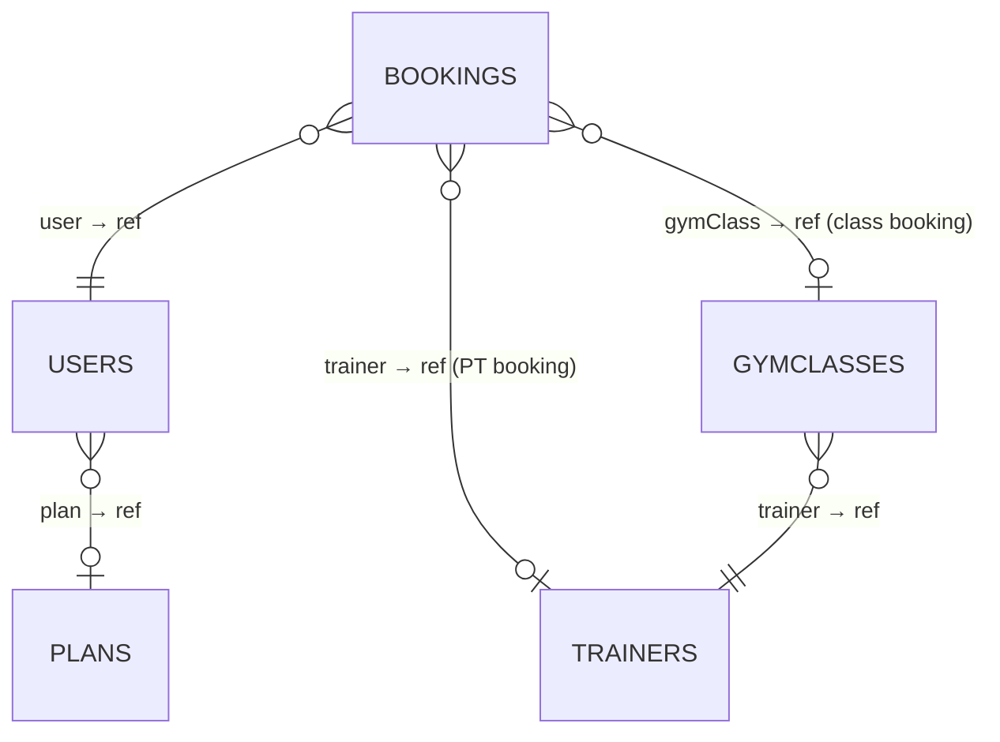

# IRONPULSE database schema

MongoDB Atlas, database `ironpulse`, modelled with Mongoose (`server/src/models/`).
Five collections. A field marked **→ ref** stores the `_id` of a document in another collection.

Every document also gets `_id` (ObjectId) and `createdAt` / `updatedAt` (Date) automatically.

## users

| Field | Type | Rules |
| --- | --- | --- |
| `name` | String | required, trimmed, max 80 |
| `email` | String | required, **unique**, lowercase, must look like an email |
| `passwordHash` | String | required; bcrypt hash, never the real password, never sent to the client |
| `role` | String | `member` or `admin`, default `member` |
| `plan` | ObjectId **→ ref `plans`** | the member's current plan, `null` until one is chosen |
| `planStartedAt` | Date | when the current plan started, `null` by default |

## plans

| Field | Type | Rules |
| --- | --- | --- |
| `name` | String | required, **unique** (Basic, Pro, Elite, Transform, Athlete) |
| `priceMonthly` | Number | required, ≥ 0 (USD) |
| `classesPerMonth` | Number | ≥ 0; `null` = unlimited |
| `ptSessionsPerMonth` | Number | ≥ 0 |
| `perks` | [String] | list of extras, e.g. "24/7 access" |
| `order` | Number | display order on the Plans page |

## trainers

| Field | Type | Rules |
| --- | --- | --- |
| `name` | String | required |
| `photoUrl` | String | optional |
| `bio` | String | max 1000 |
| `specialties` | [String] | e.g. ["Yoga", "Pilates"] |
| `yearsExperience` | Number | ≥ 0 |
| `weeklyAvailability` | [{ `day`: Number 0–6, `start`: String "HH:MM", `end`: String "HH:MM" }] | when the trainer takes PT sessions (0 = Sunday) |

## gymclasses

One document per scheduled session, e.g. "HIIT Burn, Monday 18:00".

| Field | Type | Rules |
| --- | --- | --- |
| `title` | String | required |
| `category` | String | one of HIIT, Cycling, Yoga, Pilates, Boxing, Strength, Mobility |
| `room` | String | default "Studio A" |
| `trainer` | ObjectId **→ ref `trainers`** | required: who teaches it |
| `startsAt` | Date | required |
| `durationMin` | Number | 15–180 |
| `capacity` | Number | ≥ 1; spots left = capacity − active bookings |

## bookings

A booking is either a spot in a class (`type: "class"`) or a 1-hour session with a trainer (`type: "pt"`).

| Field | Type | Rules |
| --- | --- | --- |
| `user` | ObjectId **→ ref `users`** | required: always taken from the login token, never from the request |
| `type` | String | `class` or `pt` |
| `gymClass` | ObjectId **→ ref `gymclasses`** | set when `type` is `class` |
| `trainer` | ObjectId **→ ref `trainers`** | set when `type` is `pt` |
| `startsAt` | Date | required |
| `status` | String | `booked` or `cancelled`, default `booked` |

Indexes that enforce the booking rules:
- unique (`user`, `gymClass`) for active class bookings: a member can't book the same class twice;
- unique (`trainer`, `startsAt`) for active PT bookings: a trainer can't be booked twice at the same time.

## Where each screen's data lives

| Screen | Reads | Writes |
| --- | --- | --- |
| Home | (static content) | none |
| Plans | `plans` | `users.plan` when a plan is chosen |
| Classes | `gymclasses` + `trainers` (name), spots left counted from `bookings` | `bookings` (type class) |
| Trainers / Trainer profile | `trainers` | `bookings` (type pt) |
| Sign up / Log in | `users` | `users` (new account) |
| My Dashboard | `users` + its `plan`, the member's `bookings` | cancel = `bookings.status` |
| Admin | all five collections | `plans`, `trainers`, `gymclasses` |
